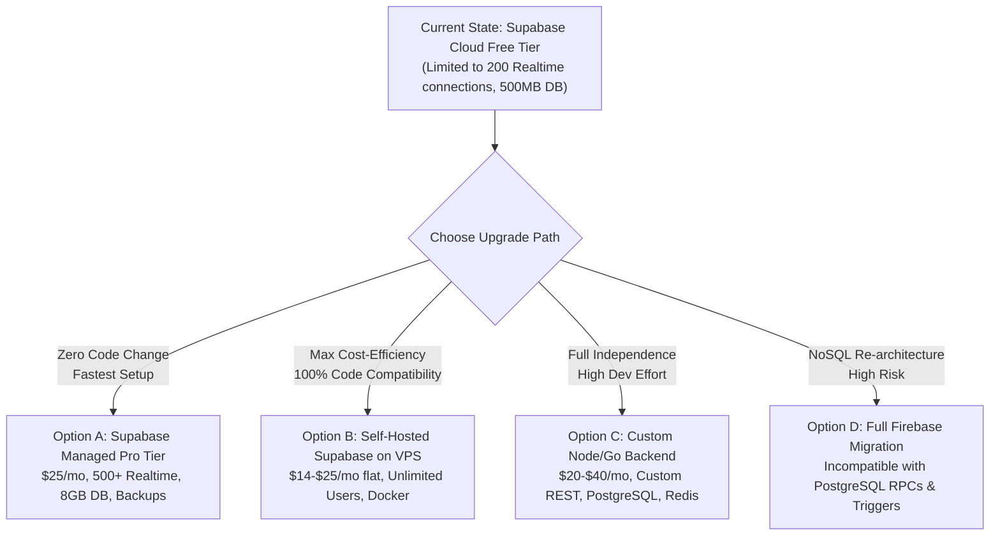
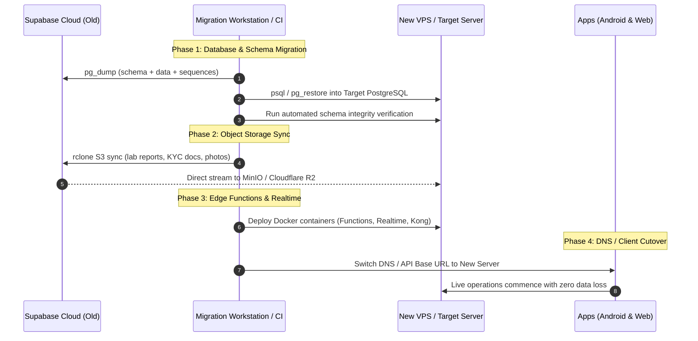

# Dactor Platform: Server Architecture Sizing, Infrastructure Research & Full Migration Plan

> **Scope**: Research, server sizing calculations, cloud/VPS infrastructure alternatives, and step-by-step database/storage/auth/function migration guide.  
> **Status**: Informational / Research Blueprint (Zero existing application code or website code modified).  
> **Applicable Stack**: Android Apps (`patient-app`, `clinic-app` in Kotlin), Web Portal (`web-app` in React/Vite), Supabase (PostgreSQL 15+, PostgREST, Realtime, Storage, Edge Functions), Firebase (Auth & FCM).

---

## Executive Summary

The perception that *"our Supabase is not enough for 1,000 users"* stems directly from the hard technical ceilings and throttles imposed on **Supabase Cloud's Free Tier**, rather than a limitation of Supabase or PostgreSQL itself.

On the Free Tier:
1. **Realtime WebSocket connections are capped at 200 concurrent connections**. In a healthcare app with live queue tracking, when patient count approaches or exceeds 200 simultaneous users, connections are dropped with `429 Too Many Requests`.
2. **Database connections are restricted** (15 direct connections, ~60 pooler connections). Multiple clinic managers, receptionists, and patients refreshing queues cause connection pool exhaustion (`FATAL: remaining connection slots are reserved`).
3. **Database disk storage is capped at 500 MB** and **File storage at 1 GB**. Patient profiles, appointments, queue history, audit logs, and medical lab reports quickly hit these thresholds.
4. **Shared micro-vCPU and 500 MB RAM** result in CPU throttling during heavy stored procedure executions (such as `create_patient_appointment`, proximity geohashing, and queue updates).

The core technology behind Supabase (PostgreSQL, PostgREST, GoTrue, Elixir Realtime, MinIO/S3, and Deno) can effortlessly handle **100,000+ users** when properly provisioned.

This report evaluates:
- Exactly **what server hardware, specifications, and architecture** you need for 1,000 to 10,000 active users.
- **Top 4 architectural alternatives** with cost, performance, and maintenance trade-offs.
- A **complete, step-by-step technical migration manual** to move the entire backend (PostgreSQL schema, RPCs, RLS, data, Firebase auth integration, private storage files, and edge functions) to an independent server with zero data loss.

---

## 1. Workload Analysis: What Does "1,000 Users" Mean for Dactor?

In medical clinic software, user metrics must be broken into concurrent activity patterns:

| Metric | Estimated Volume | Technical Impact on Backend |
| :--- | :--- | :--- |
| **Total Registered Accounts** | 1,000 - 10,000 | ~10 MB to 50 MB database space (trivial for PostgreSQL) |
| **Daily Active Users (DAU)** | 300 - 800 patients & staff/day | Moderate query volume spread over 12 daylight hours |
| **Peak Concurrent Users (Rush Hour)** | **80 - 250 simultaneous users** (8:00 AM - 11:00 AM queue rush) | Heavy load on Realtime WebSockets, connection pooler, and appointment RPCs |
| **Live Queue Status Subscriptions** | 100 - 200 persistent WebSockets | Demands ~500 MB to 1 GB RAM on the Realtime daemon |
| **Database Transactions / Sec (TPS)** | 15 - 50 queries/sec peak | Requires fast NVMe disk I/O (IOPS) and indexed query cache |
| **Storage Ingestion (Lab Reports & KYC)** | 50 - 200 MB new PDFs/images daily | Requires expandable block storage or S3-compatible object storage |

---

## 2. Server Sizing: What Kind of Server Do You Really Need?

To self-host the entire Dactor backend (PostgreSQL + PostgREST + Supabase Realtime + Storage + Auth + Kong Gateway + Edge Functions Runner) for **1,000 to 5,000 users**, you do **not** need an expensive enterprise cluster. A single modern Virtual Private Server (VPS) is more than sufficient.

### Recommended Production Server Specifications

```
+-----------------------------------------------------------------------------------+
|                           RECOMMENDED VPS SIZING                                 |
+-----------------------------------------------------------------------------------+
|  CPU         : 4 vCPU cores (Modern AMD EPYC, Intel Xeon, or ARM64 Ampere/Graviton)|
|  RAM         : 8 GB RAM (16 GB recommended if hosting Edge Functions on-box)     |
|  Disk        : 80 GB to 160 GB NVMe SSD (Minimum 1,500 IOPS)                      |
|  Network     : 1 Gbps port, minimum 20 TB monthly bandwidth                       |
|  OS          : Ubuntu 22.04 LTS or Debian 12 (64-bit)                            |
+-----------------------------------------------------------------------------------+
```

### Memory Allocation Breakdown (8 GB Server Profile)

```
+--------------------------------------------------------------------------+
|  Service                                    | Target Memory Budget      |
+--------------------------------------------------------------------------+
|  PostgreSQL Database (Shared Buffers + Cache)| 2.5 GB - 3.5 GB           |
|  PgBouncer / Supavisor Connection Pooler     | 256 MB                    |
|  PostgREST (Auto REST API engine)            | 512 MB                    |
|  Supabase Realtime (Phoenix/Elixir Engine)   | 1.0 GB - 1.5 GB           |
|  Storage API (MinIO / Local S3 service)      | 512 MB                    |
|  Kong API Gateway                            | 384 MB                    |
|  GoTrue / Auth Service                       | 256 MB                    |
|  Deno / Node Edge Functions Engine           | 512 MB - 1.0 GB           |
|  OS Overhead, Redis & Docker Engine          | 768 MB                    |
|  TOTAL                                       | ~7.0 GB (within 8 GB RAM) |
+--------------------------------------------------------------------------+
```

### Recommended Hosting Providers & Exact Costs

| Provider | Instance Type | vCPU / RAM / Disk | Monthly Cost | Best For |
| :--- | :--- | :--- | :--- | :--- |
| **Hetzner Cloud** *(Top Pick)* | **CPX31** | 4 vCPU (AMD) / 8 GB RAM / 160 GB NVMe | **~€13.50 (~$14.50 USD)** | Best raw compute performance per dollar globally; 20 TB traffic. |
| **Hetzner Cloud** *(High Memory)*| **CX42** | 8 vCPU (Intel) / 16 GB RAM / 160 GB SSD | **~€21.90 (~$23.50 USD)** | High concurrency headroom for 10,000+ users. |
| **DigitalOcean** | **Basic Droplet** | 4 vCPU / 8 GB RAM / 160 GB SSD | **$48.00 USD** | Global data centers, 1-click snapshots, simple UI. |
| **Contabo** | **Cloud VPS M** | 6 vCPU / 16 GB RAM / 400 GB SSD | **~$11.50 USD** | Lowest cost for high RAM, though single-core CPU speed is moderate. |
| **AWS Lightsail** | **Standard** | 4 vCPU / 8 GB RAM / 160 GB SSD | **$40.00 USD** | Amazon infrastructure with predictable flat billing. |
| **AWS EC2** | **t4g.xlarge** | 4 vCPU (ARM) / 16 GB RAM + 100 GB gp3 | **~$55.00 USD** | Enterprise AWS ecosystem, VPC peering, IAM integration. |

---

## 3. Architecture Options Comparison

There are 4 viable paths forward. Here is how they stack up against each other for Dactor:



### Deep Dive Comparison Matrix

| Criteria | Option A: Supabase Pro (Managed) | Option B: Self-Hosted Supabase (VPS) | Option C: Custom Backend (Node/Go + Postgres) | Option D: Full Firebase (Firestore) |
| :--- | :--- | :--- | :--- | :--- |
| **Code Changes in Mobile Apps** | **0 changes** | **0 changes** (only update base URL & key in config) | **Massive rewrite** (replace `supabase-kt` with Retrofit/Ktor) | **Massive rewrite** (replace SQL with Firestore SDK) |
| **Code Changes in Web App** | **0 changes** | **0 changes** (only update `.env` URL/key) | **Massive rewrite** (replace `@supabase/supabase-js`) | **Massive rewrite** |
| **Stored Procedures & Triggers** | 100% Preserved | 100% Preserved | Preserved (or moved to Node services) | **Lost completely** (Firestore has no SQL triggers/RPCs) |
| **Row Level Security (RLS)** | 100% Preserved | 100% Preserved | Must be re-coded into API middleware | Re-written as Firestore Security Rules |
| **Realtime WebSockets** | 500 concurrent (expandable) | **Unlimited** (bounded only by server RAM) | Custom (Redis + Socket.io / Fastify) | Realtime snapshots |
| **Monthly Cost** | $25/mo + compute add-ons | **$14 - $25/mo flat** | $15 - $40/mo (VPS + Managed DB) | Pay-per-read/write (can spike unpredictably) |
| **Maintenance Burden** | Zero (Managed by Supabase) | Moderate (Docker Compose, OS updates, backups) | High (Microservices, security, CI/CD) | Zero (Managed by Google) |
| **Time to Implement** | **15 minutes** | **1 - 2 days** | **4 - 8 weeks** | **6 - 10 weeks** |
| **Suitability for Dactor** | ⭐⭐⭐⭐⭐ (Easiest immediate fix) | ⭐⭐⭐⭐⭐ (Best long-term balance) | ⭐⭐⭐ (Clean, but high engineering cost) | ❌ (Not recommended for relational health queues) |

---

## 4. End-to-End Migration Blueprint: Migrating from Supabase to a New Server

If you decide to migrate away from Supabase Cloud to an independent server (such as a Hetzner/DigitalOcean VPS or AWS EC2), follow this exhaustive, component-by-component procedure.



---

### Component 1: PostgreSQL Database Migration

Dactor relies on complex database primitives:
- Extensions: `uuid-ossp`, `pgcrypto`.
- Custom Enums: `clinic_type_enum`, `verification_status_enum`, `kyc_status_enum`, `payment_status_enum`, `checkin_status_enum`, `queue_status_enum`, `user_role_enum`, etc.
- Custom Stored Procedures / RPCs: `create_patient_appointment`, `get_public_queue_status`, `get_nearby_clinics`, `verify_guest_appointment_identity`, `verify_and_get_lab_report_meta`, etc.
- Triggers: `prevent_appointment_tampering`, `prevent_role_escalation`, etc.
- 15+ relational tables with foreign keys and Row Level Security (RLS).

#### Step 1.1: Exporting from Supabase Cloud
From your local terminal or VPS, run `pg_dump` targeting the Supabase direct database connection string (Port 5432 or Transaction Pooler 6543):

```bash
# 1. Export entire public schema (DDL schema + table data + sequences)
pg_dump \
  --host="db.YOUR_PROJECT_REF.supabase.co" \
  --port=5432 \
  --username="postgres" \
  --dbname="postgres" \
  --schema="public" \
  --no-owner \
  --no-privileges \
  --quote-all-identifiers \
  --file="dactor_public_dump.sql"

# 2. Export storage metadata (so file references in storage.objects match bucket IDs)
pg_dump \
  --host="db.YOUR_PROJECT_REF.supabase.co" \
  --port=5432 \
  --username="postgres" \
  --dbname="postgres" \
  --schema="storage" \
  --no-owner \
  --no-privileges \
  --file="dactor_storage_meta_dump.sql"
```

> [!IMPORTANT]
> Always pass `--no-owner` and `--no-privileges`! Supabase uses cloud-specific roles (e.g., `supabase_admin`, `authenticator`) that do not exist on a vanilla PostgreSQL server.

#### Step 1.2: Importing into the New PostgreSQL Server
On your new server:

```bash
# 1. Create target database and activate extensions
psql -U postgres -d postgres -c "CREATE DATABASE dactor_db;"
psql -U postgres -d dactor_db -c "CREATE EXTENSION IF NOT EXISTS \"uuid-ossp\";"
psql -U postgres -d dactor_db -c "CREATE EXTENSION IF NOT EXISTS \"pgcrypto\";"

# 2. Import schema and data
psql -U postgres -d dactor_db -f dactor_public_dump.sql
psql -U postgres -d dactor_db -f dactor_storage_meta_dump.sql

# 3. Synchronize table sequences (prevents primary key ID collision on next insert)
psql -U postgres -d dactor_db -c "
DO \$\$
DECLARE
    r RECORD;
BEGIN
    FOR r IN SELECT sequence_name, table_name, column_name 
             FROM information_schema.sequences 
             JOIN information_schema.columns ON column_default LIKE '%' || sequence_name || '%'
             WHERE sequence_schema = 'public' LOOP
        EXECUTE format('SELECT setval(''%I'', COALESCE(MAX(%I), 1)) FROM %I', r.sequence_name, r.column_name, r.table_name);
    END LOOP;
END \$\$;
"
```

#### Step 1.3: Data Verification Script
Run a cross-check to guarantee zero row loss:

```sql
SELECT 
    schemaname,
    relname AS table_name,
    n_live_tup AS row_count
FROM pg_stat_user_tables
ORDER BY relname;
```
Compare these counts against the Supabase table statistics for `profiles`, `clinics`, `doctors`, `appointments`, `billing_invoices`, `queue_entries`, `lab_reports`, and `fcm_tokens`.

---

### Component 2: Authentication Migration (The Firebase Advantage)

One of Dactor's strongest architectural advantages is that **client authentication is handled via Firebase Auth**, with user records synchronized to Supabase via `profiles.firebase_uid` and custom token validation (`current_auth_sub()`).

#### Why this is a massive advantage:
- In pure Supabase applications, user passwords and bcrypt salts are stored inside the private `auth.users` schema. Migrating them requires sensitive password-hash dumps or forcing users to reset their passwords.
- In Dactor, **passwords, phone number OTP credentials, and Google OAuth sessions are managed by Firebase Auth**.
- When you migrate to a new server:
  1. **Users do not need to reset passwords**.
  2. The Android apps (`patient-app` and `clinic-app`) continue to authenticate against Firebase.
  3. The new server simply validates the incoming Firebase ID token using the official `firebase-admin` SDK or a public JWKS verifier, matching `sub` (Firebase UID) with `public.profiles.firebase_uid`.

---

### Component 3: Storage (Files & Medical Documents) Migration

Dactor utilizes 5 distinct storage buckets configured in `migration_private_storage.sql`:
1. `lab-reports-private` (Encrypted / restricted lab results)
2. `doctor-kyc-private` (Medical licenses, citizenship, certificates)
3. `clinic-docs-private` (Registration documents, PAN certificates)
4. `clinic_photos` (Public clinic showcase pictures)
5. `doctor_photos` (Public doctor profile avatars)

#### Migration Method: High-Speed S3 Sync with `rclone`
Supabase Storage is S3-compatible under the hood. You can use `rclone` to transfer all files directly to your new S3 bucket, Cloudflare R2, or a self-hosted MinIO instance without downloading them to your personal computer.

**`rclone.conf` configuration:**
```ini
[supabase-storage]
type = s3
provider = Other
env_auth = false
access_key_id = <YOUR_SUPABASE_STORAGE_ACCESS_KEY>
secret_access_key = <YOUR_SUPABASE_STORAGE_SECRET_KEY>
endpoint = https://<PROJECT_REF>.supabase.co/storage/v1/s3
acl = private

[new-server-storage]
type = s3
provider = Minio # Or Cloudflare / AWS
access_key_id = <NEW_ACCESS_KEY>
secret_access_key = <NEW_SECRET_KEY>
endpoint = https://storage.yourclinicdomain.com
```

**Run Migration Command:**
```bash
# Sync each bucket with multi-threaded streaming
rclone sync supabase-storage:lab-reports-private new-server-storage:lab-reports-private -P --transfers=16
rclone sync supabase-storage:doctor-kyc-private new-server-storage:doctor-kyc-private -P --transfers=16
rclone sync supabase-storage:clinic-docs-private new-server-storage:clinic-docs-private -P --transfers=16
rclone sync supabase-storage:clinic_photos new-server-storage:clinic_photos -P --transfers=16
rclone sync supabase-storage:doctor_photos new-server-storage:doctor_photos -P --transfers=16
```

---

### Component 4: Edge Functions Migration

Currently, Dactor has three Deno-based Edge Functions in `supabase/functions/`:
1. `appointment-payment`: Server-to-server eSewa payment HMAC hash generation and transaction verification callback.
2. `document-access`: Server-authorized signed upload/download URL generation enforcing ownership checks and MIME allowlists.
3. `send-fcm-alert`: Firebase Cloud Messaging push notification dispatcher.

#### Migration Options:
- **If Self-Hosting Supabase**: You can run the official `supabase/edge-runtime` Docker container, which runs the exact same Deno functions without changing a single line of TypeScript code!
- **If Migrating to a Standalone Backend**: Package these 3 functions into a lightweight Node.js/Express or Fastify service:
  ```
  /api/v1
    ├── /payments/initiate (appointment-payment)
    ├── /payments/verify (eSewa callback)
    ├── /storage/authorize-upload (document-access)
    ├── /storage/signed-url (document-access)
    └── /notifications/send-fcm (send-fcm-alert)
  ```

---

### Component 5: Realtime / Live Queue Migration

In Dactor, live queue updates and instant notifications are broadcasted via Supabase Realtime (Phoenix Elixir engine listening to PostgreSQL logical replication / WAL changes on `notifications` and `queue_entries`).

- **On Self-Hosted Supabase**: The `realtime` Docker container connects directly to PostgreSQL's `wal2json` or `pgoutput` plugin. Realtime subscriptions work identically with zero client code changes.
- **On a Custom Server**:
  - Deploy **Redis** for pub/sub messaging.
  - When an appointment status changes, PostgreSQL triggers `pg_notify` or the API writes an event to Redis.
  - A WebSocket server (e.g. Socket.io, `ws`) broadcasts the queue update to connected mobile clients.

---

### Component 6: Zero-Downtime Client Cutover Strategy

Mobile applications (`patient-app` and `clinic-app`) are distributed as compiled Android APKs/AABs. **You cannot force 100% of mobile users to update their app on the same day.**

To ensure uninterrupted service:

```
+-------------------------------------------------------------------------+
|                  THE "SMART PROXY" ZERO-UPDATE ARCHITECTURE             |
+-------------------------------------------------------------------------+
|                                                                         |
|   Mobile Apps & Web                                                     |
|   (Requesting https://api.dactorhealth.com)                             |
|                           │                                             |
|                           ▼                                             |
|               [ Cloudflare / Reverse Proxy ]                            |
|                 (Controlled by DNS CNAME)                               |
|                           │                                             |
|             ┌─────────────┴─────────────┐                               |
|             │ (Today)                   │ (After Migration)             |
|             ▼                           ▼                               |
|      Supabase Cloud              New Dedicated VPS                      |
|      (Old Server)                (New Self-Hosted Server)               |
|                                                                         |
+-------------------------------------------------------------------------+
```

1. **Best Practice Recommendation**: Configure a custom API domain (e.g. `api.dactorhealth.com` or `backend.dactorhealth.com`) via Cloudflare or Nginx reverse proxy.
2. Point your Android apps to `api.dactorhealth.com`.
3. When migration day arrives, update the proxy origin target from Supabase Cloud to your new VPS IP.
4. **Result**: 100% of existing Android app installations transition to the new server instantly without requiring any APK update or Play Store review delay!

---

## 5. Cost & Maintenance Comparison Over 1 Year

| Item | Supabase Cloud (Free Tier) | Supabase Pro Tier | Self-Hosted Supabase (Hetzner VPS + Cloudflare R2) | Custom Standalone Stack (Node + Postgres + MinIO) |
| :--- | :--- | :--- | :--- | :--- |
| **Server / Cloud Fee** | $0/mo | $25/mo ($300/yr) | ~€14/mo (~$180/yr) | ~$25/mo (~$300/yr) |
| **User Limit** | 200 Realtime / 500MB DB | 500 Realtime / 8GB DB | **Unlimited** (Up to VPS capacity) | **Unlimited** |
| **Storage Cost** | Free up to 1GB | Free up to 100GB | Cloudflare R2: First 10GB free, $0.015/GB (0 egress fee) | Local VPS disk or R2 |
| **Development Cost** | $0 | **$0 (Zero code refactor)** | **$0 (Zero code refactor)** | **$3,000 - $6,000** (dev hours to rewrite networking & APIs) |
| **Admin Effort** | None (crashes at 200 users) | Zero maintenance | Low (Automated backups, Docker health) | High (Continuous maintenance of custom API) |
| **Total 1-Year Cost** | Unviable for 1,000 users | **~$300 USD** | **~$180 - $220 USD** | **~$3,300+ USD** |

---

## 6. Strategic Verdict & Next Steps

1. **Immediate Solution (0 to 7 Days)**:
   - If your application is actively hitting limits right now in production, the fastest, zero-risk solution is **upgrading Supabase Cloud to the Pro Tier ($25/mo)**. This immediately unlocks 500 concurrent Realtime connections, 8 GB database storage, 100 GB file storage, and automated daily backups with **zero lines of code changed**.
2. **Ideal Medium-to-Long Term Solution (Self-Hosting Supabase)**:
   - When user growth continues toward 5,000 - 10,000 users, deploy **Self-Hosted Supabase via Docker Compose on a Hetzner CPX31 VPS (€13.50/mo)**.
   - You get **unlimited concurrent users**, complete data sovereignty, full control over PostgreSQL tuning, and 100% compatibility with your existing Kotlin Android apps and React web app.
3. **Avoid Full Re-writes**:
   - Do **not** rewrite Dactor in Node.js/Go or Firebase Firestore unless you have a dedicated backend engineering team with 2 months of spare time. Dactor's core strengths (authoritative appointment creation, anti-tampering triggers, least-privilege RLS, and patient isolation) are deeply integrated into PostgreSQL. Preserving that architecture saves months of redundant development.

---
*Report prepared for Dactor Platform Architecture Review.*
